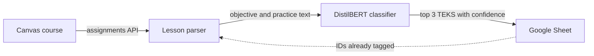

# TEKS Classifier — Automatic Standards Alignment for Lesson Plans

> Reads a teacher's lesson plans straight from Canvas and uses a fine-tuned DistilBERT model to predict which Texas US History standards (TEKS) each lesson covers, then writes the top three guesses with confidence scores to a Google Sheet for review.

Built as my high-school Computer Science Project (2024–25). Ran unattended every night on GitHub Actions from February to October 2025.

---

## What It Does

Texas teachers are expected to tie every lesson to the state's [TEKS](https://en.wikipedia.org/wiki/Texas_Essential_Knowledge_and_Skills) standards. US History alone has over 100 of them, such as *16.A: Analyze causes of economic growth and prosperity in the 1920s*. TEKS Classifier does the first pass automatically:

1. **Fetch** every assignment in a Canvas course through the Canvas REST API
2. **Parse** each lesson plan's HTML down to the parts that describe what is taught (the objective, essential question, and practice activities) and drop logistics like "DO NOW" warm-ups
3. **Classify** that text with a fine-tuned DistilBERT model, returning the three most likely TEKS codes with probabilities
4. **Append** one row per new lesson to a shared Google Sheet in a single API call, skipping lessons that are already there



The central challenge is that real lesson plans look nothing like the model's training data, which is short paraphrases of each standard. The parser narrows that gap. The evaluation measures it honestly: teachers often list a lesson's TEKS themselves, so the parser withholds that list from the model and reuses it as an answer key.

---

## Tech Stack

| Layer | Technology | Why |
|---|---|---|
| Language | **Python 3.10+** | First-class ML ecosystem and mature client libraries for both Canvas and Google Sheets |
| Model | **DistilBERT** (`distilbert-base-uncased`, 66M parameters) | Small enough to train and run on a CPU, which matters on a free CI runner |
| Training | **Hugging Face AutoTrain** and **`transformers.Trainer`** | AutoTrain produced the [published model](https://huggingface.co/connork0/10Batch25Epoch2Grad); `training/train.py` reproduces the setup locally |
| Inference | **PyTorch** + **Transformers** | Loads the model from the Hugging Face Hub by name, with no model files in the repo |
| Data source | **Canvas LMS API** (`canvasapi`) | Lesson plans already live in the course, so teachers do nothing extra |
| HTML parsing | **BeautifulSoup** | Lesson plans are rich-text HTML written in Canvas's editor |
| Output | **Google Sheets API** (`gspread`, service account) | A shared sheet the teacher can review and correct; a service account needs no browser login |
| Scheduling | **GitHub Actions** (cron) | Nightly runs with no server to maintain |
| Testing | **pytest** + GitHub Actions CI | Unit tests run in seconds without downloading the model |

---

## Architecture Highlights

### Heading-Aware Lesson Parser
Teachers structure plans as bold headings ("LEARNING OBJECTIVE:", "GUIDED PRACTICE -") followed by paragraphs, but they format them inconsistently. [`lesson_parser.py`](teks_classifier/lesson_parser.py) walks the HTML tree and treats a bold run as a heading only when it starts a paragraph or heading tag, is at most five words, and contains no digits. That separates real headings from emphasis like "political issues such as **Indian policies**" and from bolded standard codes like "**USH.3A** Analyze…". Text is grouped by normalized heading, and only an allow-list of instructional sections reaches the model.

### Top-k Predictions With Confidence
[`classifier.py`](teks_classifier/classifier.py) runs a softmax over all standards and returns the top three with probabilities, formatted like `16.A (61%)`. Showing three ranked guesses with confidence turns the output into a short list a teacher can check quickly. Inputs are truncated to 128 tokens to match how the model was trained.

### Stateless, Idempotent Sync
The Google Sheet is the only record of what has been processed. Each run reads the sheet's ID column, classifies only assignments that are missing, and appends them all in one `append_rows` call. If the upload fails, nothing is marked done and the same rows are retried the next night. Canvas IDs are compared as strings, because Canvas returns integers while anything read back from a sheet is text.

### Real-World Evaluation Without Hand Labeling
[`evaluate.py`](teks_classifier/evaluate.py) collects the TEKS each teacher cited in their own lessons, whether written as "History 3C, 12A" or as a bulleted list of "USH.5A - …" standards, and scores the model against them. A unit test checks that the cited codes never leak into the model's input.

| Evaluation | Top-1 | Top-3 |
|---|---|---|
| Held-out paraphrases, same style as training data (AutoTrain validation) | 53.7% | — |
| **Real lesson plans**, scored against teacher-cited TEKS (26 lessons) | **23%** | **27%** |
| Random guessing on those same lessons | 2% | 6% |

On real lessons the model is about 10× better than chance, but well below its score on training-style text. See [Engineering Challenges](#engineering-challenges) for why and what would close the gap.

---

## Project Structure

```
teks_classifier/
  __main__.py          # CLI: python -m teks_classifier [--dry-run]
  pipeline.py          # Canvas assignments → spreadsheet rows (no I/O, fully unit-tested)
  lesson_parser.py     # Lesson-plan HTML → classifier input, plus the teacher's cited TEKS
  classifier.py        # DistilBERT wrapper returning top-k TEKS with probabilities
  sheets.py            # Google Sheets access via service account
  config.py            # Settings from environment variables / .env
  evaluate.py          # Accuracy against teacher-cited TEKS
training/
  train.py             # Fine-tunes DistilBERT with a per-standard stratified split
data/
  teks_training_data.csv   # 537 examples across 107 standards
tests/                 # pytest suite for the parser and pipeline
.github/workflows/     # CI: runs the tests on every push
```

---

## Getting Started

**Prerequisites:** Python 3.10+, a Canvas access token for the course, and a Google Cloud [service account](https://docs.gspread.org/en/latest/oauth2.html#for-bots-using-service-account) with the sheet shared to its email address.

```bash
git clone https://github.com/connorK0/TEKS-Classifier.git
cd TEKS-Classifier
python -m venv .venv
source .venv/bin/activate          # Windows: .venv\Scripts\activate
pip install -r requirements.txt
```

Copy `.env.example` to `.env` and fill it in:

```env
CANVAS_URL=https://your-school.instructure.com
CANVAS_TOKEN=...
CANVAS_COURSE_ID=...
GOOGLE_SHEET_ID=...
GOOGLE_SERVICE_ACCOUNT_FILE=service-account.json

# Optional: a Hugging Face model ID or local path
# TEKS_MODEL=models/teks-distilbert
```

```bash
python -m teks_classifier --dry-run    # preview predictions without touching the sheet
python -m teks_classifier              # append predictions for new lessons to the sheet
python -m teks_classifier.evaluate     # score the model against teacher-cited TEKS
python training/train.py           # fine-tune a new model
python -m pytest                   # run the unit tests
```

The lesson plans used for evaluation belong to the teacher whose course this ran on, so they aren't included in the repo.

---

## Engineering Challenges

**Training data that doesn't look like real input.** The model learned from 537 one-sentence paraphrases of the standards, about five per standard. Real lesson plans are long HTML documents full of classroom logistics. That domain gap is why accuracy falls from 54% on training-style text to 23% on real lessons, and why the model falls back on the same few standards when it is unsure. The parser recovers some of the gap by feeding the model only the objective and activity text. The real fix is to train on the lessons teachers have already tagged, which the evaluation pipeline already extracts. The published model was also trained on an earlier version of the dataset that stopped at standard 27, so it can't predict 13 of the 107 standards. Retraining with `training/train.py` covers all of them.

**Measuring accuracy without labeling anything by hand.** Teachers cite standards in at least three formats ("History 3C, 12A", "USH 3B", and bulleted "USH.5A - Analyze…" lists that quote the full standard). The extractor only reads the lesson's own TEKS section, accepts optional prefixes and dots, and won't mistake "the 1920s" for a code. Lessons cite about two standards on average while the model predicts one label, so top-3 accuracy is the fairer measure. A multi-label output layer would fit the problem better.

**Fitting a model on consumer hardware.** The first version tried to fine-tune Llama 3.2 1B on a local GPU and ran into out-of-memory errors. I switched to DistilBERT, which is nearly 20× smaller, trains on a laptop CPU, and runs inference on a free GitHub Actions runner.

**Making a nightly job safe to re-run.** The original version tracked progress in four local JSON files that were committed back to the repo after every run. Canvas returns IDs as integers, but JSON round-trips them as strings, so every lesson was uploaded twice. The current design keeps no local state: the sheet is the source of truth, IDs are compared as strings, rows go up in one batch, and a failed run is simply retried.

**Keeping credentials out of source control.** All settings come from environment variables or a git-ignored `.env`, the Sheets connection uses a service account instead of a stored user refresh token, and `.gitignore` blocks common credential filenames.

---

## License

Released under the [MIT License](LICENSE).
